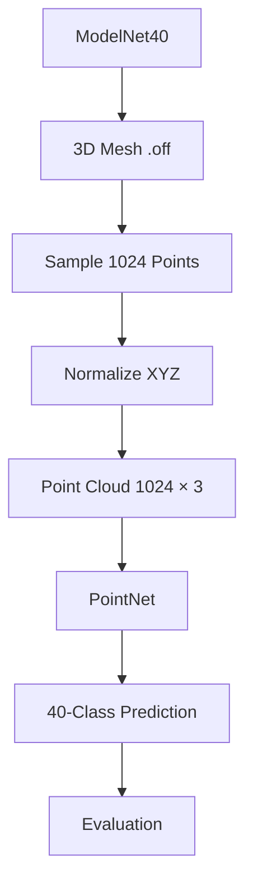
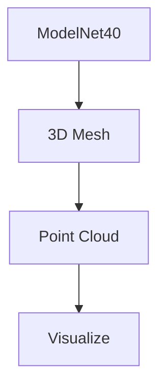
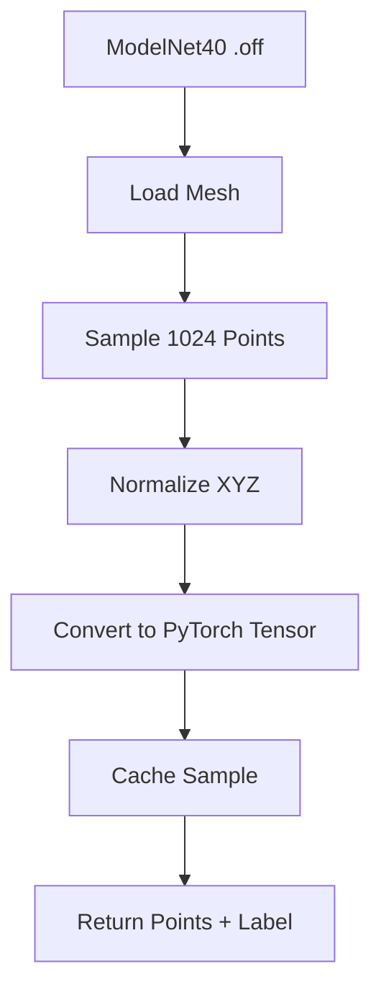
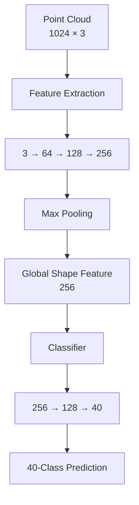
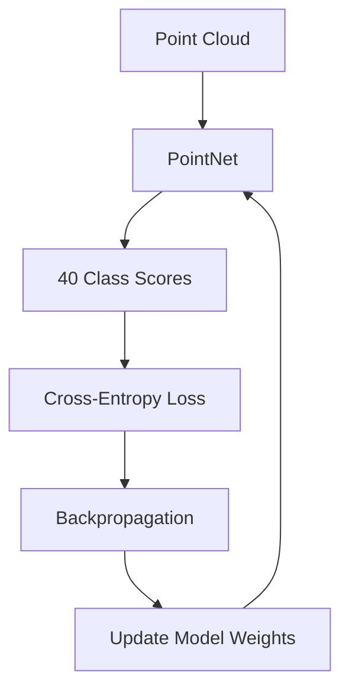
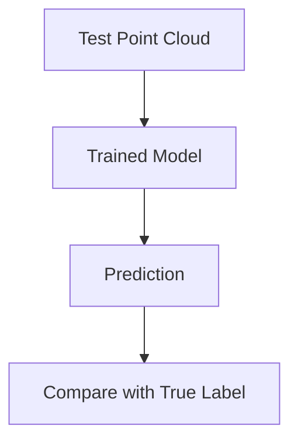

# ModelNet40 + PointNet 3D object classification

This project uses the ModelNet40 3D object dataset to classify objects into 40 categories.

The input starts as a 3D mesh. Each mesh is converted into a 1024-point point cloud containing XYZ coordinates. The project then compares a simple PointNet-style model with a pretrained PointNeXt model to evaluate their classification performance.

## Dataset

- Dataset: ModelNet40
- Classes: 40 object categories
- Input: 3D mesh files (.off)
- Point Cloud: 1024 XYZ points per object

## Project Workflow


### 1. View Data

The first step is to understand the input data by visualizing both the original 3D mesh and the converted point cloud.
This helps verify that the mesh is loaded correctly and that the point-cloud conversion produces the expected 3D shape.

#### Data Flow



#### Run

```
python -m utils.view_data
```

### 2. Create Dataset Class

The ModelNet40Dataset class loads ModelNet40 .off mesh files, converts each mesh into a 1024-point XYZ point cloud, normalizes the points, and caches the processed data to speed up training.

#### Data Flow



#### Convert Mesh to Point Cloud

A mesh contains vertices and faces that describe the surface of a 3D object. For this project, the mesh is converted into a fixed-size point cloud so that the neural network can process the object as a set of XYZ coordinates.

Each object is represented by:

1024 points × 3 coordinates

[X, Y, Z]
[X, Y, Z]
[X, Y, Z]
...

#### Normalize

Normalization puts all objects into a similar coordinate range, allowing the model to focus on their shape and geometric features instead of their absolute size.

For example, imagine two chairs:

Chair A: 1 meter tall
Chair B: 2 meters tall

Their coordinates could look like:

Chair A:
[0.2, 0.1, 0.5]

Chair B:
[0.4, 0.2, 1.0]

They may have a similar shape, but their coordinate scales are different.

### 3. Create Simple PointNet

The project uses a lightweight PointNet-style neural network for 3D point-cloud classification.

The model extracts features from the 3D points, uses max pooling to create a global representation of the object, and then predicts one of the 40 object categories.

#### Model Architecture



#### Learn Point Features

Each point contains only three values:

X, Y, Z

These coordinates alone do not directly describe the complete shape of the object.

The network transforms each point:

3 → 64 → 128 → 256

The model learns different features from the coordinates. Increasing the feature dimension gives the network more capacity to learn geometric patterns and more complex representations.

#### Understand the Object with Max Pooling

After feature extraction, each of the 1024 points has 256 learned features.

1024 points × 256 features

Max pooling finds the strongest value for each feature across all 1024 points.

1024 × 256 → Max Pooling → 256

This produces a 256-feature global representation of the object.

The representation summarizes the important geometric features of the entire point cloud.

#### 3.3 Classifier

The classifier takes the 256 global features and transforms them into 128 features before producing 40 class scores.

256 → 128 → 40

The final output contains one score for each ModelNet40 category.

The class with the highest score becomes the model's prediction.

### 4. Train

The PointNet model is trained using Cross-Entropy Loss and the Adam optimizer.

#### Training Flow



#### Cross-Entropy Loss

Cross-Entropy Loss measures how well the model's prediction matches the correct class.

During training, the model tries to reduce the loss by updating its weights.

The training process repeats for multiple epochs so that the model can gradually learn better features for 3D object classification.

#### Run

```
python -m src.train
```

### 5. Evaluate

After training, the model is evaluated using the test dataset.

The test data contains objects that were not used to update the model's weights during training.

#### Evaluation Flow



#### Run

```
python -m src.evaluate
```